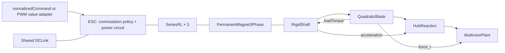
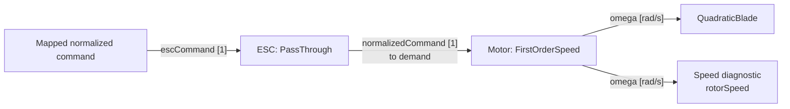
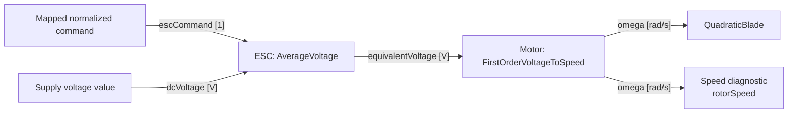
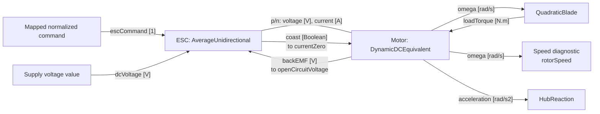
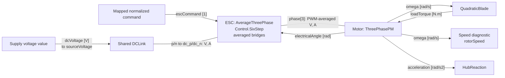
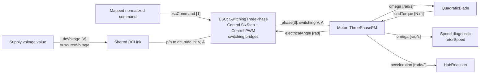

# Propulsion modeling and configuration

[한국어 번역](propulsion_modeling_ko.md)

**This English document is the source of truth.** Update it first, then synchronize
[the Korean translation](propulsion_modeling_ko.md). If the versions differ, the
English version takes precedence.

This document describes the **implemented P0–P4 compositions** in
`fire_modelica_models`: equations, units, initial conditions, configuration and
validation scope. The world frame is NED, the body frame is FRD, and local +z is
the propeller thrust direction. All physical parameters use SI units.

FastDyn's `docs/local/modelica/MULTICOPTER_INTERFACES.md` v0.8 proposed a future
PMSM dq/FOC model for P3. The P3/P4 profiles documented here implement the
subsequently agreed **known-position, six-step, three-phase abc model**. P3
averages PWM switching; P4 represents individual switching events.
**FOC, dq current controllers and sensorless startup are not implemented.**

## 1. Fidelity levels and intended use

| Level | `[models].esc` | `[models].motor` | Modeled behavior |
|---|---|---|---|
| P0 | `pass_through` | `first_order_speed` | First-order response to a normalized target speed |
| P1 | `average_voltage` | `first_order_voltage_to_speed` | First-order speed response to average voltage |
| P2 | `average_unidirectional` | `dynamic_dc_equivalent` | DC-equivalent winding current, electromagnetic torque, shaft inertia and load |
| P3 | `average_three_phase` | `three_phase_pm` | Phase currents and back-EMF, six-step commutation and PWM-average power |
| P4 | `switching_three_phase` | `three_phase_pm` | The same motor as P3, with explicit PWM current ripple and diode conduction |

All examples use `quadratic_blade`, the **R0** rotor model. Selecting P4 does not
increase the fidelity of propeller aerodynamics, the rigid body or sensors.
P0/P1 are empirical responses and do not require current, power or inertia
parameters. P2 equivalent parameters and P3/P4 phase parameters have different
definitions. The example TOML values are illustrative, not identified motor data.

### 1.1 Normalized commands and the ESC–motor interface

All levels use `escCommand` in [0, 1] after actuator-channel mapping. In the VIO
profile, `pwm` is a numeric pulse width in microseconds. `Adapters.VirtualIO.PwmInput`
converts each channel before the composer applies `geometry.actuatorIndex`:

\[
u=\operatorname{clamp}\!\left(
\frac{pwm-pwm_{min}}{pwm_{max}-pwm_{min}},\,0,\,1
\right).
\]

The `plant` profile accepts `normalizedCommand` directly. Both profiles then use
the same ESC–motor composition. `omega` is the **motor's mechanical-speed output**;
the composer connects it to `QuadraticBlade.omega` and exposes it as `rotorSpeed`.

| Level | Meaning of normalized command `u` | ESC–motor boundary | Common motor output |
|---|---|---|---|
| P0 | Target-speed fraction: `omegaCommand = omegaMax * u` | ESC `normalizedCommand` → motor `demand`, a dimensionless signal | `omega` [rad/s] |
| P1 | Voltage modulation ratio | ESC `equivalentVoltage = u * dcVoltage` → motor `equivalentVoltage`, a voltage-valued signal | `omega` [rad/s] |
| P2 | DC-equivalent voltage modulation ratio | Conserving electrical terminals `p/n`; motor `backEMF` → ESC `openCircuitVoltage`, and ESC `coast` → motor `currentZero` | `omega` [rad/s] |
| P3 | High-side duty command for six-step commutation | Conserving ABC terminals `phase[3]` of an averaged inverter; motor `electricalAngle` → ESC `electricalAngle` | `omega` [rad/s] |
| P4 | High-side duty command for six-step commutation | Conserving ABC terminals `phase[3]` of a PWM-switching inverter; motor `electricalAngle` → ESC `electricalAngle` | `omega` [rad/s] |

Thus `u = 0.5` requests half of `omegaMax` only in P0, with the configured
first-order lag. In P1–P4, speed follows the voltage-driven model; P2–P4 also
respond directly to load torque. The command is not a thrust fraction.
The VIO pulse-width command and P4's internal high-frequency PWM are distinct:
`Control.PWM` generates switch gate pulses inside the ESC.

## 2. Composition and state ownership

The following overview shows the physical composition used by P3/P4.



| Owner | Responsibility / state |
|---|---|
| `Physical.Electrical.Drives.Control.SixStep` | Rotor-position-based commutation and the stop-recirculation latch |
| `Physical.Electrical.Drives.Control.PWM` | P4 PWM periods and gate turn-on times |
| `Physical.Electrical.Drives.ESC.*ThreePhase` | DC/ABC power terminals, controller/bridge assembly and loss diagnostics |
| `Physical.Electrical.Drives.Bridges` | Averaged high-side drive or individual switches, low-side drive and body diodes |
| `Physical.Electrical.Passives.SeriesRL` | General R–L circuit; current and magnetic energy |
| `Physical.Electrical.Electromechanical.PermanentMagnet3Phase` | Back-EMF and torque conversion; contains no R/L/J |
| `Systems.Propulsion.Motors.ThreePhasePM` | Three windings with a floating neutral, the conversion element and shaft assembly |
| `Physical.Mechanical.Rotational.RigidShaft` | Speed, mechanical angle, rotational energy and friction |
| `Systems.Power.DCLink` | The shared vehicle DC-link capacitor voltage state |
| `Systems.Propulsion.HubReaction` | Axial moment transferred to the vehicle; no rotational state |

`Physical.Electrical.Drives.Control` contains the ESC's internal signal logic:
`SixStep` selects the conducting phases and coast policy; `PWM` generates
gate pulses and applies turn-on delays. `Bridges` models the power circuit,
and `ESC` assembles both. These signal blocks belong to the electrical drive;
the top-level `Controllers` package is reserved for higher-level control laws.

In the normal free-shaft configuration, each P3/P4 motor has two independent
current states, one mechanical-angle state and one speed state. The supply adds
one capacitor state per vehicle. PWM/controller discrete states are separate.
The ESC and `HubReaction` do not integrate shaft inertia again.

The diagrams below show one ESC–motor pair after channel mapping. Arrows
(`-->`) carry directed signals; plain lines (`---`) connect conserving electrical
terminals whose voltages and currents are solved together. A plain line does
not by itself imply that the drive allows regeneration. `rotorSpeed` is an alias
of the motor's `omega`, not another speed state. Mechanical/body connections
beyond the shown motor ports are omitted.

For P1–P4, the top-level `dcVoltage` is an input in the `plant` profile and a
configuration parameter in `vio`. P1/P2 pass that value directly to the ESC;
P3/P4 use it as `DCLink.sourceVoltage` and connect the ESC to the resulting DC bus.

### 2.1 P0: normalized speed demand



`PassThrough` forwards the normalized command. `FirstOrderSpeed` has one signal
input, `demand`, and one output, `omega`. P0 has no supply-voltage input, electrical
terminals or load-torque feedback.

### 2.2 P1: voltage-valued signal



`AverageVoltage` also exposes `modulation` as a diagnostic output. Its
`equivalentVoltage` is a scalar signal, not an electrical terminal carrying
current. `FirstOrderVoltageToSpeed` outputs `omega`; aerodynamic load torque
does not feed back into this empirical speed response.

### 2.3 P2: DC-equivalent electrical terminals



P2 adds both physical electrical coupling and load-torque feedback. The auxiliary
`backEMF` and `coast` signals implement the blocked-current boundary: `currentZero`
is a zero-current event, not a command to erase current at cutoff.

Additional ESC outputs are `modulation`, `terminalVoltage`, `motorCurrent`,
`dcCurrent`, `electricalPower` and `freewheel`. Additional motor outputs are
`current`, `electromagneticTorque`, `copperLoss`, `frictionLoss`, `loadPower` and
`storedEnergy`; `backEMF`, `omega` and `acceleration` are shown above.

### 2.4 P3: averaged three-phase drive



The ESC contains `Control.SixStep` and three `Bridges.AverageHalfBridge` legs.
It measures phase currents through its electrical terminals for commutation/coast
logic; there is no separate external phase-current signal input. The explicit
`electricalAngle` feedback supplies ideal rotor position. P3 averages the PWM
carrier and has no `Control.PWM` instance.

Additional ESC outputs are `phaseCurrent[3]`, `dcCurrent`, `dcVoltage`,
`electricalPower`, `motorPower`, `lossPower`, `coast` and `recirculating`.
Additional motor outputs are `phaseCurrent[3]`, `backEMF[3]`,
`electromagneticTorque`, `copperLoss`, `frictionLoss`, `loadPower` and
`storedEnergy`. P3/P4 do not connect `coast` to a motor `currentZero` input.

### 2.5 P4: PWM-switching three-phase drive



P4 has the same external ESC/motor ports and diagnostic outputs as P3. Inside
`SwitchingThreePhase`, `Control.SixStep` supplies modulation and phase selection;
`Control.PWM` converts them into Boolean gate signals for three
`Bridges.SwitchingHalfBridge` legs. `pwmFrequency` and `deadTime` are ESC
parameters, not additional VIO command inputs. The motor receives switched phase
voltages through `phase[3]`, so winding inductance resolves current ripple.

## 3. P0 and P1: empirical speed responses

Clamp the normalized command as follows:

\[
u=\operatorname{clamp}(u_{in},0,1).
\]

P0:

\[
\tau\dot\omega=\omega_{max}u-\omega.
\]

P1:

\[
V_{eq}=uV_{dc},\qquad
\tau_\omega\dot\omega=K_vV_{eq}-\omega.
\]

`Kv` is in **(rad/s)/V**. Multiply an rpm/V value by \(2\pi/60\) to convert it.
P1 voltage is an input to the motor-speed response, not a physical power port.
Neither model feeds aerodynamic torque back into its speed equation. Motor lag
is applied once.

## 4. P2: DC-equivalent electromechanical model

\[
V_m=Ri+L\dot i+k\omega,\qquad \tau_{em}=ki,
\]

\[
J_\Sigma\dot\omega=\tau_{em}-b\omega-Q,
\qquad J_\Sigma=J_{motor}+J_{prop}.
\]

`SeriesRL` itself is a bidirectional passive element. `AverageUnidirectional`
owns the unidirectional equivalent-current policy. During driven operation,
\(V_m=uV_{dc}\) and \(I_{dc}=ui\). After command cutoff, residual positive
current decays through a freewheel path. When it reaches zero, the drive enters
an open-circuit state with \(V_m=k\omega\). The motor's `currentZero` event
projects the state at that zero crossing; **it does not erase current at command
cutoff**.

\[
E_m=\tfrac12Li^2+\tfrac12J_\Sigma\omega^2,\quad
P_{Cu}=Ri^2,\quad P_f=b\omega^2,\quad P_{load}=Q\omega.
\]

P2 uses the same SI-defined equivalent constant `k` for torque and back-EMF.
Do not copy per-phase BLDC/PMSM data directly into this parameter.

## 5. Shared P3/P4 three-phase motor

### 5.1 Terminals and electrical angle

`phase[3]` contains the A/B/C terminals. The internal neutral is floating and is
not connected to DC negative or ground. Phase current is positive **from the ESC
into the motor**.

\[
i_a+i_b+i_c=0,\qquad
\theta_e=p\theta_m+\theta_0,\qquad \dot\theta_m=\omega.
\]

`polePairs=p` is half the pole count. `theta0` is an **electrical angle [rad]**.
`omega` is mechanical speed along the selected forward shaft direction. The
physical CW/CCW mounting direction is applied separately to the vehicle moment
through `geometry.spinSign`.

### 5.2 Windings and electromechanical conversion

\[
v_j-v_n=R_{ph}i_j+L_{ph}\dot i_j+e_j,
\qquad j\in\{a,b,c\},
\]

\[
e_j=k_e\omega f_j(\theta_e),\qquad
\tau_{em}=k_e\sum_j f_j(\theta_e)i_j.
\]

`ke` is **peak phase back-EMF per mechanical rad/s**, in V·s/rad. `polePairs`
already determines the electrical angle; do not introduce an additional
pole-pair factor into this torque equation. Torque is defined at standstill
because the calculation does not divide by speed.

\[
\sum_j e_ji_j=\tau_{em}\omega.
\]

`trapezoidal=true` selects a unit-peak waveform with a +1 plateau from 30–150°,
a −1 plateau from 210–330°, and linear segments between them. B/C lag A by
120°/240°, respectively. `false` selects
\(f_j=\sin(\theta_e-2\pi(j-1)/3)\).
**Selecting a sinusoidal motor retains six-step control; it does not enable FOC.**
For sinusoidal current in phase with back-EMF and a current peak of \(I_{pk}\),
\(\tau_{em}=\tfrac32k_eI_{pk}\).

The shaft equation is the same as P2. Magnetic/rotational energy and copper loss
are:

\[
E_m=\tfrac12L_{ph}\sum_j i_j^2+\tfrac12J_\Sigma\omega^2,
\qquad P_{Cu}=R_{ph}\sum_j i_j^2.
\]

### 5.3 Scope of `SeriesRL × 3` and initialization

`LPhase` is the **effective phase inductance** of a symmetric winding. With
constant self/mutual inductances \(L_s,M\) and \(\sum i_j=0\), the model can be
reduced to \(L_{ph}=L_s-M\). Three independent `SeriesRL` elements do not
represent a general coupled inductance matrix. Saliency, position-dependent
inductance, saturation, delta windings and zero-sequence current are outside
this model's scope.

For a simple symmetric wye winding measured with the third line open,
\(R_{line-line}=2R_{ph}\) and \(L_{line-line}=2L_{ph}\).
Check the frequency, rotor position and winding connection used for measured
inductance. Converting line-to-line RMS back-EMF or rpm/V into `ke` also requires
the waveform and measurement conventions.

The three `i_start` values must sum to zero. `SeriesRL.fixedCurrentStart` retains
its existing default of `true`; the three-phase motor fixes A/B initial currents
and obtains C from KCL. It does not fix all three as independent initial states.
Mechanical angle starts at zero; `theta0` sets the initial electrical offset.

## 6. Commutation, PWM and coast

### 6.1 Common six-step control

\[
s=1+\left\lfloor\frac{\operatorname{mod}(\theta_e+\pi/6,2\pi)}{\pi/3}\right\rfloor.
\]

| Sector | Selected high side | Selected low side |
|---:|---|---|
| 1 | C | B |
| 2 | A | B |
| 3 | A | C |
| 4 | B | C |
| 5 | B | A |
| 6 | C | A |

A positive command modulates the selected high side and turns on the selected
low side. The controller commands forward drive but **does not restrict phase
current signs**. Rotor position is assumed to be known exactly. Speed control,
current limiting and phase-advance control are not included.

When the command becomes zero or negative:

1. Turn off high-side drive.
2. Retain the low side selected immediately before cutoff to recirculate residual current.
3. When \(\max_j|i_j|\le I_{release}\), turn off that switch and enter Hi-Z.

No current state is reset and no stored energy is deleted. An initially zero
command starts in Hi-Z. Body diodes remain connected with all gates off. High
back-EMF or residual magnetic energy can produce \(I_{dc}<0\), and instantaneous
torque need not remain positive. Decay time depends on rotor angle at cutoff.
This model does not represent regeneration-blocking hardware or complete
physical disconnection.

### 6.2 P3 averaged circuit

The selected high side uses the following PWM continuous-conduction-mode (CCM)
reduction. \(v_h\) is its phase voltage relative to DC negative.

\[
\bar V_h=uV_{bus}-(1-u)V_D,\qquad
\bar R_h=uR_{on}+(1-u)R_D,
\]

\[
I_h=\max\left(0,\frac{\bar V_h-v_h}{\bar R_h}\right),\qquad
I_{dc,h}=uI_h.
\]

For an unselected high side, \(I_h=0\). The low side and body-diode paths to
both rails remain separate circuit elements. During conduction, the reduced
high-side loss is:

\[
P_{loss,h}=\bar R_h I_h^2+(1-u)V_DI_h.
\]

The `max` operation is an algebraic approximation that blocks reverse average
drive current. **It does not reconstruct discontinuous conduction within a PWM
cycle.** Agreement with P4 averages is not guaranteed during commutation
transients, at very small duty or with large bus ripple. Additional \(I^2R\)
loss from PWM ripple is not calculated directly.

### 6.3 P4 switching circuit

Each phase contains upper/lower `IdealClosingSwitch` elements and antiparallel
`IdealDiode` elements. There are six switches in total, parameterized by `Ron`,
`Rdiode`, `Vdiode` and `Goff`.

\[
T_{PWM}=1/f_{PWM},\qquad
h_j=h_{selected,j}\land(t-t_k<uT_{PWM}).
\]

`sample(0,T_PWM)` updates the start of each PWM period. This is an **internal ESC
carrier**, separate from the VirtualIO command pulse-width value and the host
communication interval. Sensor sampling is not added.

`deadTime` delays requested turn-on; turn-off is immediate. An assertion rejects
simultaneous upper/lower gate commands on the same leg. The selected low side
remains on throughout PWM; the low-side body diode provides freewheel conduction
during high-side off intervals. The implementation does not compensate for the
duty reduction from turn-on delay. During normal switching periods, the
effective high-side duty is approximately \(\max(u-f_{PWM}t_d,0)\).

Switch transition time, gate charge, reverse recovery, parasitic C/L, EMI and
transition energy are not modeled. `escLoss` contains the implemented conduction,
diode and off-conductance losses, not a detailed switching-loss model.

### 6.4 Numerical parameters

`Goff=1e-5 S` corresponds to a finite off resistance of 100 kΩ. It regularizes
the floating-phase circuit solution; it is not a calibrated MOSFET leakage value.
Its current and loss are included in the energy balance. Hi-Z current is not
mathematically exactly zero.

The default `currentThreshold=1e-3 A` is the gate-release threshold. When changing
`Goff`, voltage or back-EMF, check that the threshold is sufficiently above the
residual leakage. An excessively small `Goff` can worsen the floating phase's
fast time scales and numerical conditioning. Assess solver convergence and
sensitivity to this regularization when interpreting results.

## 7. Shared DC link and power balance

The P3/P4 composer creates one `Systems.Power.DCLink` per vehicle. It contains
an ideal voltage source \(V_s\), series resistance \(R_s\) and bus capacitor
\(C_{dc}\).

\[
I_s=\frac{V_s-V_{bus}}{R_s},\qquad
C_{dc}\dot V_{bus}=I_s-\sum_r I_{dc,r}.
\]

\[
E_{bus}=\tfrac12C_{dc}V_{bus}^2,\quad
P_s=V_sI_s,\quad P_{bus,loss}=R_sI_s^2.
\]

For P3/P4, `power.dcVoltage` and the plant's `dcVoltage` input specify the
**upstream ideal voltage source**. `busVoltage` reports the actual ESC supply
voltage. Initial capacitor voltage is fixed to the configured `power.dcVoltage`.
Overriding the plant input with a different initial voltage produces a bus
charging transient from that difference.

The ideal source can absorb returned energy. This is not a battery model with
SOC, OCV, temperature, charging limits or a BMS. When replacing the supply
circuit directly, connect every ESC's `dc_p/dc_n` to the common bus and define
the reference potential once at the supply. ESCs contain no internal ground.

The ESC and motor power balances are:

\[
P_{dc}=V_{bus}I_{dc},\quad
P_{motor}=\sum_j(v_j-v_{dc-})i_j,\quad
P_{esc,loss}=P_{dc}-P_{motor},
\]

\[
\frac{d}{dt}\left(E_{bus}+\sum_r E_{m,r}\right)
=P_s-P_{bus,loss}-\sum_r
\left(P_{esc,loss,r}+P_{Cu,r}+P_{f,r}+Q_r\omega_r\right).
\]

## 8. Aerodynamic load and vehicle moment

For forward shaft rotation, R0 uses:

\[
F_r=\{0,0,k_T\omega^2\},\quad Q=k_Q\omega^2,\quad
M_{aero,r}=\{0,0,-sQ\}.
\]

P2/P3/P4 feed `Q` back to the shaft as `loadTorque`. Under the fixed-carrier,
axial approximation, `HubReaction` computes:

\[
M_{hub,r}=M_{aero,r}-\{0,0,sJ_\Sigma\dot\omega\}.
\]

The vehicle rotates this wrench and adds the moment arm about its CG once:

\[
F_b=R_{br}F_r,\qquad M_{CG,b}=r_b\times F_b+R_{br}M_{hub,r}.
\]

Adding motor-housing reaction again would double count it. `HubReaction` does
not integrate rotor motion. Full coupling between vehicle angular acceleration
and the shaft, and gyroscopic effects, are not implemented. Physical component
masses enter the vehicle mass/inertia budget once; `J/JLoad` describe relative
spin energy. R0 reverse-rotation and windmilling aerodynamics are outside scope.

## 9. Configuration

Complete examples: [quad P3](../configs/quad_p3.toml),
[quad P4](../configs/quad_p4.toml), [hexa P3](../configs/hex_p3.toml) and
[hexa P4](../configs/hex_p4.toml).

```toml
schema_version = 3
model_name = "ConfiguredQuadP4"

[geometry]
preset = "QuadX"
nActuators = 4
actuatorIndex = [3, 2, 4, 1]

[models]
esc = "switching_three_phase" # P3: "average_three_phase"
motor = "three_phase_pm"
rotor = "quadratic_blade"

[motor]
RPhase = 0.2      # ohm / phase
LPhase = 0.001    # H / effective phase
ke = 0.01        # V_peak_phase / (mechanical rad/s)
polePairs = 7
trapezoidal = true
J = 0.0001       # kg.m2, motor rotor only
b = 0.0          # N.m.s/rad
omega_start = 0.0
theta0 = 0.0    # electrical rad

[esc]
Ron = 0.005
Rdiode = 0.005
Vdiode = 0.5
Goff = 1e-5
currentThreshold = 0.001
pwmFrequency = 20000.0 # P4 only; remove for P3
deadTime = 0.0        # P4 only; remove for P3

[rotor]
J = 0.0001       # propeller inertia; added to motor.J exactly once
kT = 0.00001
kQ = 0.00000015

[power]
dcVoltage = 16.0
sourceResistance = 0.02
dcLinkCapacitance = 0.002

[landing_gear]
enabled = false
```

The numbers are illustrative. To select P3, change the ESC selection and remove
`pwmFrequency` and `deadTime`. P3 does not silently ignore unused P4 fields.

| Table / key | Requirement and allowed range |
|---|---|
| `motor.RPhase, LPhase, ke, J` | Required for P3/P4; positive |
| `motor.polePairs` | Required; integer ≥ 1 |
| `motor.b, omega_start` | Default 0; nonnegative |
| `motor.theta0` | Default 0; finite signed electrical angle |
| `motor.trapezoidal` | Default true; Boolean |
| `motor.i_start` | Default all zero; if supplied, shape `[nRotors,3]`, each row sums to zero; signed A |
| `esc.Ron, Rdiode` | Required; positive |
| `esc.Vdiode` | Required; nonnegative |
| `esc.Goff` | Default `1e-5`; positive |
| `esc.currentThreshold` | Default `1e-3`; positive |
| `esc.pwmFrequency` | Required for P4; positive Hz |
| `esc.deadTime` | P4 default 0; `0 ≤ deadTime < 0.5/pwmFrequency` |
| `rotor.J` | Required for P2/P3/P4; nonnegative |
| `rotor.kT, kQ` | Defaults `1e-5`, `1.5e-7`; nonnegative |
| `power.dcVoltage` | Required; nonnegative V |
| `power.sourceResistance, dcLinkCapacitance` | Required for P3/P4; positive |

Ordinary motor/ESC/rotor parameters accept a scalar or a length-`nRotors` array,
for example `polePairs=[7,7,5,5]` or `theta0=[0,0.2,0.4,0.6]`.
Only `i_start` requires the full two-dimensional array. `power` parameters are
vehicle-wide scalars. Parameter arrays use **rotor order**; `actuatorIndex`
separately maps command channels.

### 9.1 Emission and external interfaces

From the library root:

```bash
cargo run --manifest-path tools/fire-compose/Cargo.toml -- emit \
  configs/quad_p3.toml --profile plant --output-dir build/quad_p3
cargo run --manifest-path tools/fire-compose/Cargo.toml -- emit \
  configs/hex_p4.toml --profile vio --output-dir build/hex_p4
```

- `plant`: exposes `normalizedCommand[nActuators]` and the upstream `dcVoltage` input.
- `vio`: retains the existing `pwm[nActuators]` boundary and sensor outputs.
  `dcVoltage` is an internal parameter set by the configuration.
- The value normalized with `pwm_min/max` is a high-side duty command. It is
  neither a thrust ratio nor a target-speed command, and is independent of the
  ESC's internal carrier frequency.
- Invalid dimensions, P2 fields with different parameter conventions, unused PWM
  fields and incompatible ESC/motor combinations are rejected before emission.
- The manifest records `P3/P4`, the abc/floating-star contract, control mode,
  supply/energy-return policy, PWM/commutation/diode events and actual class names.
  `emit` does not establish compilation success; verification states remain
  `not_run`.

### 9.2 Diagnostic outputs

| Output | Shape | Meaning |
|---|---|---|
| `rotorSpeed` | `[nRotors]` | Mechanical rad/s |
| `phaseCurrent` | `[nRotors,3]` | Signed ABC current in A; a different contract from P2's scalar `motorCurrent` |
| `backEMF` | `[nRotors,3]` | Phase back-EMF in V |
| `electricalAngle` | `[nRotors]` | Unwrapped electrical angle in rad |
| `dcCurrent, electricalPower` | `[nRotors]` | Each ESC's DC current/power; may be negative |
| `electromagneticTorque, loadTorque` | `[nRotors]` | Motor torque and aerodynamic load in N.m |
| `copperLoss, frictionLoss, escLoss, loadPower` | `[nRotors]` | Individual losses/load power in W |
| `storedEnergy` | `[nRotors]` | Winding + rotational energy in J; excludes DC-link energy |
| `busVoltage, totalDcCurrent` | Scalar | Actual bus voltage and summed ESC current |
| `sourceCurrent, sourcePower, busLoss, busStoredEnergy` | Scalar | Upstream source, series loss and capacitor energy |

## 10. Validation and limitations

Runnable examples: [ThreePhaseCoast](../Examples/ThreePhaseCoast.mo) and
[SwitchedThreePhaseCoast](../Examples/SwitchedThreePhaseCoast.mo).

```bash
python3 tools/verify.py --output build/verification
FIRE_TEST_OMC=1 python3 -m unittest discover -s tools -p 'test_*.py'
python3 tools/probe_p34.py --output build/p34-validation
```

Validation covers the ABC current sum, electrical-angle/ke/torque conventions,
integrated energy balance, current continuity at cutoff, recirculation-to-Hi-Z,
restart and gate-off energy return from an initially fast-spinning rotor.
The P3/P4 comparison requires mean current/power differences below 1% in a CCM
benchmark with a **locked rotor, duty 0.6, 10 kHz PWM, zero dead time and a
40–50 ms averaging window**. This criterion does not extend to all operating
points or to DCM.

P4 must handle PWM edges and commutation events. Solver internal steps and FMI
communication steps are distinct. Reducing the output interval alone does not
limit internal integration steps. Vary the explicit maximum internal step and
tolerances to check convergence of means and ripple.

**Rumoca changes are outside this implementation's scope.** OpenModelica native
validation and composer emission do not establish successful FastDyn/Rumoca
FMI3 execution. The existing P2 Rumoca limitations remain. Using P3/P4 as FastDyn
firmware-execution profiles requires separate compilation, FMI event-handling
and step-convergence validation.

Battery SOC, thermal states, FOC, sensorless startup, current protection, magnetic
saturation, variable inductance, R1/R2 aerodynamics and full rotor–vehicle angular
momentum coupling are not implemented.

### 10.1 Validation results (2026-10-14)

With OpenModelica 1.26.1 / Modelica 4.0.0, 34 native simulations, including the
existing regressions, passed without warnings. Four invalid chassis configurations
were rejected as expected. Eight vehicle cases (quad/hexa × P3/P4 × plant/VIO)
and both single-motor examples also passed.

In the CCM benchmark above, the mean-current difference was **0.1236%**, the mean
ESC input-power difference was **0.2402%**, and P4 phase-current ripple was
approximately **0.1947 A peak-to-peak**. Checks that halved the maximum internal
step from 5 µs to 2.5 µs and doubled `Goff` also passed. See
[validation.md](validation.md) for detailed results and their scope.
