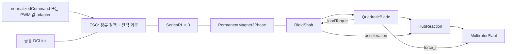
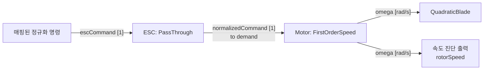
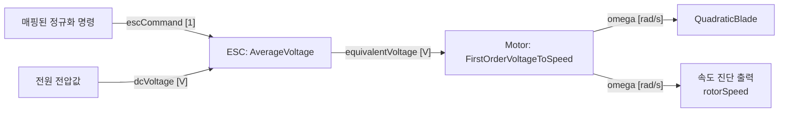
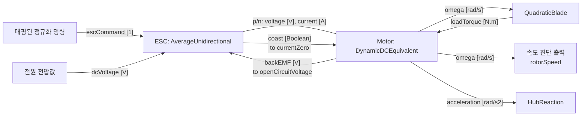
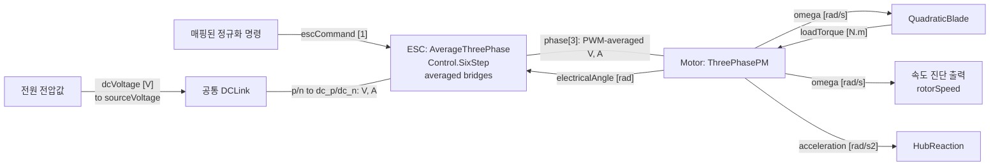
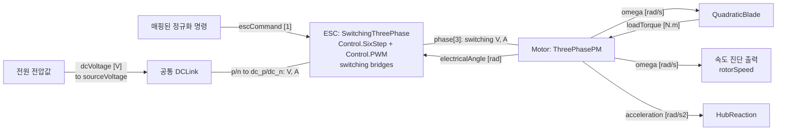

# Propulsion 모델링과 configuration

[English — 기준 문서](propulsion_modeling.md)

**영어 문서가 기준본입니다.** 이 문서는 [영어 기준본](propulsion_modeling.md)의 한국어 번역입니다.
내용을 변경할 때는 영어 기준본을 먼저 수정하고 한국어 번역을 동기화합니다.
두 문서의 내용이 다르면 영어 기준본을 따릅니다.

이 문서는 `fire_modelica_models`의 **실제 P0–P4 조립 방식**, 수식, 단위,
초기조건, configuration 및 검증 범위를 정리한다. 좌표계는 NED world / FRD body이고,
프로펠러의 local +z가 추력 방향이다. 모든 물리 파라미터는 SI 단위다.

FastDyn의 `docs/local/modelica/MULTICOPTER_INTERFACES.md` v0.8은 P3를 향후
PMSM dq/FOC 모델로 제안했다. 여기의 P3/P4는 이후 합의한 **known-position
6-step / 3상 abc 모델**이다. P3는 PWM 평균화, P4는 개별 스위칭이다.
**FOC, dq 전류 제어기, 센서리스 시동을 구현한 것으로 해석하지 않는다.**

## 1. 수준과 적용 목적

| 수준 | `[models].esc` | `[models].motor` | 계산하는 현상 |
|---|---|---|---|
| P0 | `pass_through` | `first_order_speed` | 정규화 목표 회전수의 1차 응답 |
| P1 | `average_voltage` | `first_order_voltage_to_speed` | 평균 전압에 대한 회전수의 1차 응답 |
| P2 | `average_unidirectional` | `dynamic_dc_equivalent` | DC 등가 권선 전류, 전자기 토크, 축 관성과 부하 |
| P3 | `average_three_phase` | `three_phase_pm` | 상별 전류·역기전력, 6-step 정류, PWM 평균 전력 |
| P4 | `switching_three_phase` | `three_phase_pm` | P3와 같은 모터 + 실제 PWM 전류 리플과 다이오드 도통 |

모든 예제의 rotor는 `quadratic_blade`, 즉 **R0**다. P4를 선택해도 프로펠러
공력, 강체, 센서가 자동으로 더 상세해지는 것은 아니다. P0/P1은 경험적 응답이며
전류·전력·관성 파라미터를 요구하지 않는다. P2의 등가 계수와 P3/P4의 상별 계수는
서로 다른 정의다. 예제 TOML의 수치는 실제 모터를 식별한 결과가 아니다.

### 1.1 정규화 명령과 ESC–모터 인터페이스

모든 수준은 구동기 채널 매핑 후 [0, 1] 범위의 `escCommand`를 사용한다. VIO
프로파일의 `pwm`은 마이크로초 단위의 펄스 폭을 나타내는 숫자다.
`Adapters.VirtualIO.PwmInput`이 각 채널을 다음처럼 변환하고, 이후 composer가
`geometry.actuatorIndex`를 적용한다.

\[
u=\operatorname{clamp}\!\left(
\frac{pwm-pwm_{min}}{pwm_{max}-pwm_{min}},\,0,\,1
\right).
\]

`plant` 프로파일은 `normalizedCommand`를 직접 받는다. 이후에는 두 프로파일이
같은 ESC–모터 조합을 사용한다. `omega`는 **모터의 기계적 회전속도 출력**이며,
composer가 `QuadraticBlade.omega`에 연결하고 `rotorSpeed`로 노출한다.

| 수준 | 정규화 명령 `u`의 의미 | ESC–모터 사이 연결 | 공통 모터 출력 |
|---|---|---|---|
| P0 | 목표 속도 비율: `omegaCommand = omegaMax * u` | ESC `normalizedCommand` → 모터 `demand`, 무차원 신호 | `omega` [rad/s] |
| P1 | 전압 변조율 | ESC `equivalentVoltage = u * dcVoltage` → 모터 `equivalentVoltage`, 전압값 신호 | `omega` [rad/s] |
| P2 | DC 등가 전압 변조율 | 보존형 전기 단자 `p/n`; 모터 `backEMF` → ESC `openCircuitVoltage`, ESC `coast` → 모터 `currentZero` | `omega` [rad/s] |
| P3 | 6-step 정류의 high-side 듀티 명령 | 평균화 인버터의 보존형 ABC 단자 `phase[3]`; 모터 `electricalAngle` → ESC `electricalAngle` | `omega` [rad/s] |
| P4 | 6-step 정류의 high-side 듀티 명령 | PWM 스위칭 인버터의 보존형 ABC 단자 `phase[3]`; 모터 `electricalAngle` → ESC `electricalAngle` | `omega` [rad/s] |

따라서 `u = 0.5`가 `omegaMax`의 절반을 목표로 하는 것은 P0이며, 설정된
1차 지연을 거쳐 응답한다. P1–P4에서는 전압 구동 모델에 따라 속도가 정해지고,
P2–P4에서는 부하 토크도 속도에 직접 영향을 준다. 명령은 추력 비율이 아니다.
VIO의 펄스 폭 명령과 P4 내부의 고주파 PWM은 별개다. `Control.PWM`은 ESC
내부에서 스위치 게이트 펄스를 생성한다.

## 2. 구성과 상태 소유권

다음 개요는 P3/P4의 물리적 조립 구조를 나타낸다.



| 소유자 | 역할 / 상태 |
|---|---|
| `Physical.Electrical.Drives.Control.SixStep` | 회전자 위치에 따른 정류, 정지 재순환 latch |
| `Physical.Electrical.Drives.Control.PWM` | P4 PWM 주기와 게이트 turn-on 시각 |
| `Physical.Electrical.Drives.ESC.*ThreePhase` | DC/ABC 전력 단자, 제어기와 bridge 조립, 손실 진단 |
| `Physical.Electrical.Drives.Bridges` | 평균 high-side 또는 개별 스위치, low-side와 body diode |
| `Physical.Electrical.Passives.SeriesRL` | 일반적인 R–L 회로; 전류와 자기 에너지 |
| `Physical.Electrical.Electromechanical.PermanentMagnet3Phase` | 역기전력·토크 변환; R/L/J를 포함하지 않음 |
| `Systems.Propulsion.Motors.ThreePhasePM` | 부동 중성점 권선 3개 + 변환 요소 + 축 조립 |
| `Physical.Mechanical.Rotational.RigidShaft` | 회전속도와 기계각, 관성 에너지와 마찰 |
| `Systems.Power.DCLink` | 기체가 공유하는 DC-link 커패시터 전압 상태 |
| `Systems.Propulsion.HubReaction` | 기체로 전달되는 축방향 모멘트 계산; 회전 상태 없음 |

`Physical.Electrical.Drives.Control`은 ESC 내부 신호 로직을 담는다.
`SixStep`은 도통할 상과 coast 정책을 결정하고, `PWM`은 게이트 펄스 생성과
turn-on 지연을 담당한다. `Bridges`는 전력 회로를 모델링하며 `ESC`가 두 계층을
조합한다. 이 신호 블록들은 전기 구동계에 속하고, 최상위 `Controllers` 패키지는
상위 제어 로직을 위한 공간으로 남겨둔다.

P3/P4 모터 한 개의 독립 연속 상태는 정상적인 자유 축 구성에서 전류 2개,
기계각 1개, 회전속도 1개다. 전원에는 기체당 커패시터 상태가 하나 추가된다.
PWM/controller의 이산 상태는 별도다. 관성을 ESC나 `HubReaction`에서 다시 적분하지 않는다.

아래 다이어그램은 채널 매핑 이후의 ESC–모터 한 쌍을 나타낸다. 화살표
(`-->`)는 방향이 있는 신호이고, 화살표 없는 선(`---`)은 전압과 전류를 함께
푸는 보존형 전기 단자 연결이다. 화살표 없는 선 자체가 해당 구동계의 회생을
허용한다는 뜻은 아니다. `rotorSpeed`는 모터 `omega`의 별칭이며 별도 속도 상태가
아니다. 표시된 모터 포트 이외의 기계·기체 연결은 생략했다.

P1–P4의 최상위 `dcVoltage`는 `plant` 프로파일에서는 입력이고, `vio`에서는
configuration 파라미터다. P1/P2는 이 값을 ESC에 직접 전달한다. P3/P4는
`DCLink.sourceVoltage`에 전달하고, 그 결과인 DC 버스에 ESC를 연결한다.

### 2.1 P0: 정규화 속도 명령



`PassThrough`는 정규화 명령을 그대로 전달한다. `FirstOrderSpeed`의 신호 입력은
`demand`, 출력은 `omega`다. P0에는 전원 전압 입력, 전기 단자, 부하 토크
피드백이 없다.

### 2.2 P1: 전압값 신호



`AverageVoltage`는 진단 출력 `modulation`도 제공한다. `equivalentVoltage`는
스칼라 신호이며 전류가 흐르는 전기 단자가 아니다. `FirstOrderVoltageToSpeed`는
`omega`를 출력하고, 공력 부하 토크는 이 경험적 속도 응답에 되먹임되지 않는다.

### 2.3 P2: DC 등가 전기 단자



P2에는 물리적인 전기 연결과 부하 토크 피드백이 추가된다. 보조 신호인
`backEMF`와 `coast`는 전류 차단 경계 조건을 구현한다. `currentZero`는 전류가
0에 도달하는 이벤트이며, 명령 차단 시 전류를 지우는 명령이 아니다.

추가 ESC 출력은 `modulation`, `terminalVoltage`, `motorCurrent`, `dcCurrent`,
`electricalPower`, `freewheel`이다. 추가 모터 출력은 `current`,
`electromagneticTorque`, `copperLoss`, `frictionLoss`, `loadPower`, `storedEnergy`다.
`backEMF`, `omega`, `acceleration`은 위 그림에 표시했다.

### 2.4 P3: 평균화 3상 구동



ESC 내부는 `Control.SixStep`과 `Bridges.AverageHalfBridge` 세 개로 구성된다.
정류·coast 로직에 필요한 상전류는 전기 단자에서 측정하므로 별도의 외부 상전류
신호 입력은 없다. 명시적인 `electricalAngle` 피드백은 이상적으로 알려진 회전자
위치를 제공한다. P3는 PWM 반송파를 평균화하며 `Control.PWM` 인스턴스가 없다.

추가 ESC 출력은 `phaseCurrent[3]`, `dcCurrent`, `dcVoltage`, `electricalPower`,
`motorPower`, `lossPower`, `coast`, `recirculating`이다. 추가 모터 출력은
`phaseCurrent[3]`, `backEMF[3]`, `electromagneticTorque`, `copperLoss`,
`frictionLoss`, `loadPower`, `storedEnergy`다. P3/P4에서는 `coast`를 모터의
`currentZero` 입력에 연결하지 않는다.

### 2.5 P4: PWM 스위칭 3상 구동



P4의 외부 ESC·모터 포트와 진단 출력은 P3와 같다. `SwitchingThreePhase`
내부에서 `Control.SixStep`이 변조율과 상 선택을 결정하고, `Control.PWM`이
이를 Boolean 게이트 신호로 변환해 `Bridges.SwitchingHalfBridge` 세 개에 전달한다.
`pwmFrequency`와 `deadTime`은 ESC 파라미터이며 추가 VIO 명령 입력이 아니다.
모터는 `phase[3]`로 스위칭 상전압을 전달받고, 권선 인덕턴스에 의해 전류 리플이
계산된다.

## 3. P0와 P1: 경험적 속도 응답

정규화 명령을 다음처럼 제한한다.

\[
u=\operatorname{clamp}(u_{in},0,1).
\]

P0:

\[
\tau\dot\omega=\omega_{max}u-\omega.
\]

P1:

\[
V_{eq}=uV_{dc},\qquad
\tau_\omega\dot\omega=K_vV_{eq}-\omega.
\]

`Kv`는 **(rad/s)/V**다. rpm/V는 \(2\pi/60\)을 곱해서 변환한다.
P1의 전압은 모터 속도 응답에 대한 입력이며 물리적인 전력 포트가 아니다.
두 모델 모두 공력 토크가 속도 방정식에 되먹임되지 않고, 모터 지연은 한 번만 적용된다.

## 4. P2: DC 등가 전기·기계 모델

\[
V_m=Ri+L\dot i+k\omega,\qquad \tau_{em}=ki,
\]

\[
J_\Sigma\dot\omega=\tau_{em}-b\omega-Q,
\qquad J_\Sigma=J_{motor}+J_{prop}.
\]

`SeriesRL` 자체는 양방향 수동 소자다. `AverageUnidirectional`이 등가 전류의
단방향 구동 정책을 소유한다. 구동 중에는 \(V_m=uV_{dc}\),
\(I_{dc}=ui\)이고, 명령 차단 시 남은 양의 전류는 freewheel 경로에서 감소한다.
0에 도달하면 \(V_m=k\omega\)인 개방 상태로 전환한다. 모터의 `currentZero`
이벤트는 이 0 도달 시점의 상태 보정이며 **명령 차단 시 전류를 지우는 기능이 아니다**.

\[
E_m=\tfrac12Li^2+\tfrac12J_\Sigma\omega^2,\quad
P_{Cu}=Ri^2,\quad P_f=b\omega^2,\quad P_{load}=Q\omega.
\]

P2의 `k`는 같은 SI 정의의 등가 토크 상수와 역기전력 상수다.
상별 BLDC/PMSM 데이터에서 직접 복사하지 않는다.

## 5. P3/P4 공통 3상 모터

### 5.1 단자와 전기각

`phase[3]`는 A/B/C 상 단자이고, 중성점은 내부에서 부동이다. 중성점을
DC 음극이나 ground에 연결하지 않는다. 각 전류는 **ESC에서 모터로 들어가는 방향**이 양수다.

\[
i_a+i_b+i_c=0,\qquad
\theta_e=p\theta_m+\theta_0,\qquad \dot\theta_m=\omega.
\]

`polePairs=p`는 극 수의 절반이다. `theta0`는 **전기각 [rad]**이다.
`omega`는 선택한 정방향 축의 기계 속도다. 실제 CW/CCW 장착 방향은 별도의
`geometry.spinSign`으로 기체 모멘트에 적용한다.

### 5.2 권선과 전기·기계 변환

\[
v_j-v_n=R_{ph}i_j+L_{ph}\dot i_j+e_j,
\qquad j\in\{a,b,c\},
\]

\[
e_j=k_e\omega f_j(\theta_e),\qquad
\tau_{em}=k_e\sum_j f_j(\theta_e)i_j.
\]

`ke`는 **상 역기전력 peak / 기계 rad/s**이며 단위는 V·s/rad다.
`polePairs`는 이미 전기각 계산에 사용하므로 위 토크 식에 임의로 다시 곱하지 않는다.
속도로 나누어 토크를 계산하지 않아 정지 상태에서도 정의된다.

\[
\sum_j e_ji_j=\tau_{em}\omega.
\]

`trapezoidal=true`는 30–150°에서 +1, 210–330°에서 −1인 단위 peak
사다리꼴 파형과 그 사이 선형 구간을 사용한다. B/C는 각각 120°/240° 지연된다.
`false`는 \(f_j=\sin(\theta_e-2\pi(j-1)/3)\)을 사용한다.
**정현파 모터를 선택해도 제어기는 6-step이며 FOC로 바뀌지 않는다.**
정현파에서 전류가 역기전력과 같은 위상이고 peak가 \(I_{pk}\)이면
\(\tau_{em}=\tfrac32k_eI_{pk}\)다.

축 방정식은 P2와 같다. 자기/회전 에너지와 손실은 다음과 같다.

\[
E_m=\tfrac12L_{ph}\sum_j i_j^2+\tfrac12J_\Sigma\omega^2,
\qquad P_{Cu}=R_{ph}\sum_j i_j^2.
\]

### 5.3 `SeriesRL × 3`의 범위와 초기조건

`LPhase`는 대칭 권선의 **유효 상 인덕턴스**다. 일정한 자기/상호 인덕턴스
\(L_s,M\)와 \(\sum i_j=0\)을 가정하면 \(L_{ph}=L_s-M\)로 축약할 수 있다.
개별 `SeriesRL` 세 개가 일반적인 결합 인덕턴스 행렬을 표현하는 것은 아니다.
돌극성, 위치 의존 인덕턴스, 포화, Δ결선과 zero-sequence 전류는 범위 밖이다.

단순 대칭 Y결선, 세 번째 선 개방의 측정 조건에서는
\(R_{line-line}=2R_{ph}\), \(L_{line-line}=2L_{ph}\)다.
실측 인덕턴스의 주파수·회전자 위치·결선 조건을 확인해야 한다.
선간 RMS 역기전력이나 rpm/V를 `ke`로 바꿀 때도 파형과 측정 정의가 필요하다.

`i_start`의 세 값은 합이 0이어야 한다. `SeriesRL.fixedCurrentStart`는 기존 기본값
`true`를 유지하되, 3상 모터는 A/B만 고정하고 C는 KCL에서 결정한다.
세 전류를 독립 초기 상태로 동시에 고정하지 않는다. 기계각은 0에서 시작하며,
전기각 초기 위치를 `theta0`로 설정한다.

## 6. 정류, PWM와 coast

### 6.1 공통 6-step 제어

\[
s=1+\left\lfloor\frac{\operatorname{mod}(\theta_e+\pi/6,2\pi)}{\pi/3}\right\rfloor.
\]

| sector | high-side 대상 | low-side 대상 |
|---:|---|---|
| 1 | C | B |
| 2 | A | B |
| 3 | A | C |
| 4 | B | C |
| 5 | B | A |
| 6 | C | A |

양의 명령에서는 선택된 high-side를 변조하고 선택된 low-side를 켠다.
정방향 구동만 명령하지만 **상전류의 부호를 제한하지 않는다**.
회전자 위치는 정확히 알려져 있다고 가정한다. 속도 제어·전류 제한·진각 제어는 없다.

명령이 0 이하로 바뀌면:

1. high-side 구동을 끈다.
2. 정지 직전의 low-side 하나를 유지하여 잔류 전류가 재순환하게 한다.
3. \(\max_j|i_j|\le I_{release}\)가 되면 해당 스위치도 끄고 Hi-Z로 전환한다.

전류 state를 재설정하거나 에너지를 제거하지 않는다. 처음부터 명령이 0이면
Hi-Z에서 시작한다. 모든 gate가 꺼져도 body diode는 남는다. 높은 역기전력 또는
잔류 자기 에너지 때문에 \(I_{dc}<0\)이 가능하며, 순간 토크가 항상 양수인 것도 아니다.
정지 시 회전각에 따라 감쇠 시간이 달라진다. 회생 방지 하드웨어나 완전한 절연 개방을
표현한 모델이 아니다.

### 6.2 P3 평균화 회로

선택된 high-side의 PWM 연속 전류 모드(CCM) 축약은 다음과 같다.
\(v_h\)는 해당 상의 DC 음극 기준 전압이다.

\[
\bar V_h=uV_{bus}-(1-u)V_D,\qquad
\bar R_h=uR_{on}+(1-u)R_D,
\]

\[
I_h=\max\left(0,\frac{\bar V_h-v_h}{\bar R_h}\right),\qquad
I_{dc,h}=uI_h.
\]

비선택 high-side에서는 \(I_h=0\)이다. low-side와 양 rail로 향하는 body diode는
별도 회로로 유지된다. 이 high-side 축약의 손실은 도통 시

\[
P_{loss,h}=\bar R_h I_h^2+(1-u)V_DI_h.
\]

`max`는 평균 구동 전류가 역전되는 것을 차단하는 대수적 근사다.
**PWM 주기 내부 DCM을 복원하지 않으며**, 정류 과도·아주 작은 duty·큰 bus ripple에서
P4 평균값과 일치한다고 보장하지 않는다. PWM 리플에 의한 추가 \(I^2R\) 손실도
직접 계산하지 않는다.

### 6.3 P4 스위칭 회로

각 상은 상하 `IdealClosingSwitch`와 역병렬 `IdealDiode`로 구성된다.
총 6개 스위치가 있으며, `Ron`, `Rdiode`, `Vdiode`, `Goff`를 명시한다.

\[
T_{PWM}=1/f_{PWM},\qquad
h_j=h_{selected,j}\land(t-t_k<uT_{PWM}).
\]

`sample(0,T_PWM)`가 PWM 주기 시작을 갱신한다. 이것은 VirtualIO의 명령 pulse-width
숫자나 host의 통신 주기와 다른 **ESC 내부 carrier**다. 센서 sampling은 추가하지 않는다.

`deadTime`은 요청된 turn-on을 지연시키고 turn-off는 즉시 적용한다.
동일 leg의 상하 동시 gate는 assertion으로 거부한다. 선택 low-side는 PWM 동안 유지하고,
high-side off 구간에서는 low-side body diode가 freewheel을 담당한다.
현재 방식은 turn-on 지연에 의한 duty 감소를 보상하지 않는다. 정상 주기에서
high-side 유효 duty는 대략 \(\max(u-f_{PWM}t_d,0)\)다.

스위치 천이 시간, gate charge, reverse recovery, 기생 C/L, EMI 및 천이 에너지는 없다.
`escLoss`는 구현된 도통·다이오드·off-conductance 손실이며 상세 switching loss가 아니다.

### 6.4 수치 파라미터

`Goff=1e-5 S`는 유한 off 저항 100 kΩ에 해당한다. 부동 상의 회로 해를 규정하는
정규화이며 실제 MOSFET leakage의 보정값이라고 주장하지 않는다. 이 전류와 손실도
에너지 수지에 포함한다. Hi-Z에서 전류가 수학적으로 정확히 0이 되지는 않는다.

기본 `currentThreshold=1e-3 A`는 gate 해제 기준이다. `Goff`, 전압, 역기전력을 바꾸면
잔류 leakage보다 충분히 큰 해제 기준인지 확인한다. `Goff`를 과도하게 작게 하면
부동 상의 빠른 시간척도와 조건수가 나빠질 수 있다. 결과를 해석할 때 solver 수렴과
이 정규화에 대한 민감도를 확인한다.

## 7. 공통 DC-link와 전력 수지

P3/P4 composer는 기체당 하나의 `Systems.Power.DCLink`를 생성한다.
이상 전압원 \(V_s\), 직렬 저항 \(R_s\), bus 커패시터 \(C_{dc}\)로 구성한다.

\[
I_s=\frac{V_s-V_{bus}}{R_s},\qquad
C_{dc}\dot V_{bus}=I_s-\sum_r I_{dc,r}.
\]

\[
E_{bus}=\tfrac12C_{dc}V_{bus}^2,\quad
P_s=V_sI_s,\quad P_{bus,loss}=R_sI_s^2.
\]

`power.dcVoltage`와 plant의 `dcVoltage` 입력은 P3/P4에서 **상류 이상 전압원**을 뜻한다.
ESC 실제 전압은 출력 `busVoltage`다. 초기 커패시터 전압은 configuration의
`power.dcVoltage`로 고정한다. plant 입력을 다른 초기 전압으로 override하면
그 차이에 따른 bus 충전 과도가 생긴다.

이상 전압원은 반환된 에너지를 흡수할 수 있다. SOC·OCV·온도·충전 제한·BMS를 포함한
배터리 모델은 아니다. 전원 회로를 직접 교체할 때는 모든 ESC의 `dc_p/dc_n`을 공통
bus에 연결하고 전원에서 기준 전위를 한 번 정의한다. ESC 내부에는 ground가 없다.

ESC와 모터의 에너지 수지는 다음과 같다.

\[
P_{dc}=V_{bus}I_{dc},\quad
P_{motor}=\sum_j(v_j-v_{dc-})i_j,\quad
P_{esc,loss}=P_{dc}-P_{motor},
\]

\[
\frac{d}{dt}\left(E_{bus}+\sum_r E_{m,r}\right)
=P_s-P_{bus,loss}-\sum_r
\left(P_{esc,loss,r}+P_{Cu,r}+P_{f,r}+Q_r\omega_r\right).
\]

## 8. 공력 부하와 기체 모멘트

R0는 정방향 속도 영역에서 다음을 사용한다.

\[
F_r=\{0,0,k_T\omega^2\},\quad Q=k_Q\omega^2,\quad
M_{aero,r}=\{0,0,-sQ\}.
\]

P2/P3/P4는 `Q`를 축의 `loadTorque`로 되먹임하고,
`HubReaction`은 고정 carrier의 축방향 근사에서 다음을 계산한다.

\[
M_{hub,r}=M_{aero,r}-\{0,0,sJ_\Sigma\dot\omega\}.
\]

기체는 이를 회전시키고 CG에 대한 모멘트 팔을 한 번 추가한다.

\[
F_b=R_{br}F_r,\qquad M_{CG,b}=r_b\times F_b+R_{br}M_{hub,r}.
\]

여기에 모터 housing 반작용을 다시 더하면 중복 계산이다. `HubReaction`은 rotor
움직임을 적분하는 모델이 아니다. 기체 각가속도와 shaft의 완전 결합, 자이로 효과는
구현하지 않는다. 기체 질량/관성 예산에는 실제 부품 질량이 한 번 포함되고,
`J/JLoad`는 상대 spin의 에너지를 표현한다. R0의 역회전·풍차 공력은 범위 밖이다.

## 9. Configuration

완전한 예제는 [quad P3](../configs/quad_p3.toml), [quad P4](../configs/quad_p4.toml),
[hexa P3](../configs/hex_p3.toml), [hexa P4](../configs/hex_p4.toml)에 있다.

```toml
schema_version = 3
model_name = "ConfiguredQuadP4"

[geometry]
preset = "QuadX"
nActuators = 4
actuatorIndex = [3, 2, 4, 1]

[models]
esc = "switching_three_phase" # P3: "average_three_phase"
motor = "three_phase_pm"
rotor = "quadratic_blade"

[motor]
RPhase = 0.2      # ohm / phase
LPhase = 0.001    # H / effective phase
ke = 0.01        # V_peak_phase / (mechanical rad/s)
polePairs = 7
trapezoidal = true
J = 0.0001       # kg.m2, motor rotor only
b = 0.0          # N.m.s/rad
omega_start = 0.0
theta0 = 0.0    # electrical rad

[esc]
Ron = 0.005
Rdiode = 0.005
Vdiode = 0.5
Goff = 1e-5
currentThreshold = 0.001
pwmFrequency = 20000.0 # P4 only; remove for P3
deadTime = 0.0        # P4 only; remove for P3

[rotor]
J = 0.0001       # propeller inertia; added to motor.J exactly once
kT = 0.00001
kQ = 0.00000015

[power]
dcVoltage = 16.0
sourceResistance = 0.02
dcLinkCapacitance = 0.002

[landing_gear]
enabled = false
```

예제 숫자는 설명용이다. P3로 바꿀 때는 ESC 선택을 변경하고 `pwmFrequency`,
`deadTime`을 삭제한다. 사용되지 않는 P4 필드를 P3에서 조용히 무시하지 않는다.

| table / key | 필수 여부와 허용 범위 |
|---|---|
| `motor.RPhase, LPhase, ke, J` | P3/P4 필수, 양수 |
| `motor.polePairs` | 필수, 정수 ≥ 1 |
| `motor.b, omega_start` | 기본 0, 비음수 |
| `motor.theta0` | 기본 0, 유한한 signed 전기각 |
| `motor.trapezoidal` | 기본 true, Boolean |
| `motor.i_start` | 기본 전부 0; 주면 `[nRotors,3]`, 각 행 합 0, signed A |
| `esc.Ron, Rdiode` | 필수, 양수 |
| `esc.Vdiode` | 필수, 비음수 |
| `esc.Goff` | 기본 `1e-5`, 양수 |
| `esc.currentThreshold` | 기본 `1e-3`, 양수 |
| `esc.pwmFrequency` | P4 필수, 양수 Hz |
| `esc.deadTime` | P4 기본 0; `0 ≤ deadTime < 0.5/pwmFrequency` |
| `rotor.J` | P2/P3/P4 필수, 비음수 |
| `rotor.kT, kQ` | 기본 `1e-5`, `1.5e-7`; 비음수 |
| `power.dcVoltage` | 필수, 비음수 V |
| `power.sourceResistance, dcLinkCapacitance` | P3/P4 필수, 양수 |

motor/ESC/rotor의 일반 파라미터는 scalar 또는 길이 `nRotors` 배열이다.
예: `polePairs=[7,7,5,5]`, `theta0=[0,0.2,0.4,0.6]`.
`i_start`만 전체 2차원 배열이다. `power`는 기체 공통 scalar다.
배열은 **rotor 순서**이고, 명령 채널 순서는 `actuatorIndex`로 별도 매핑한다.

### 9.1 생성과 외부 인터페이스

라이브러리 root에서:

```bash
cargo run --manifest-path tools/fire-compose/Cargo.toml -- emit \
  configs/quad_p3.toml --profile plant --output-dir build/quad_p3
cargo run --manifest-path tools/fire-compose/Cargo.toml -- emit \
  configs/hex_p4.toml --profile vio --output-dir build/hex_p4
```

- `plant`: `normalizedCommand[nActuators]`와 상류 `dcVoltage` 입력.
- `vio`: 기존 `pwm[nActuators]` 외부 경계와 센서 출력을 유지한다.
  `dcVoltage`는 configuration에 따른 내부 parameter다.
- `pwm_min/max`로 정규화한 값은 high-side duty 명령이다. 추력 비율이나
  목표 속도 명령으로 해석하지 않는다. ESC 내부 carrier 주파수와도 무관하다.
- 잘못된 차원, 단위가 다른 P2 필드, 불필요한 PWM 필드, 호환되지 않는 ESC/motor
  조합은 파일 생성 전에 거부한다.
- manifest는 `P3/P4`, abc/floating-star 계약, 제어 모드, 전원·에너지 반환 정책,
  PWM/정류/다이오드 이벤트 및 실제 클래스 이름을 기록한다. `emit`은 컴파일 성공을
  의미하지 않으며 검증 상태는 `not_run`으로 남는다.

### 9.2 진단 출력

| 출력 | shape | 의미 |
|---|---|---|
| `rotorSpeed` | `[nRotors]` | 기계 rad/s |
| `phaseCurrent` | `[nRotors,3]` | ABC signed A; P2의 scalar `motorCurrent`와 다른 계약 |
| `backEMF` | `[nRotors,3]` | 상 역기전력 V |
| `electricalAngle` | `[nRotors]` | wrap하지 않은 전기각 rad |
| `dcCurrent, electricalPower` | `[nRotors]` | 각 ESC의 DC 전류/전력; 음수 가능 |
| `electromagneticTorque, loadTorque` | `[nRotors]` | 모터 발생 토크와 공력 부하 N.m |
| `copperLoss, frictionLoss, escLoss, loadPower` | `[nRotors]` | 각 손실/부하 전력 W |
| `storedEnergy` | `[nRotors]` | 권선 + 회전 에너지 J; DC-link 에너지 제외 |
| `busVoltage, totalDcCurrent` | scalar | 실제 bus 전압과 ESC 전류 합 |
| `sourceCurrent, sourcePower, busLoss, busStoredEnergy` | scalar | 상류 전원, 직렬 손실, 커패시터 에너지 |

## 10. 검증과 적용 제한

실행 예제: [ThreePhaseCoast](../Examples/ThreePhaseCoast.mo),
[SwitchedThreePhaseCoast](../Examples/SwitchedThreePhaseCoast.mo).

```bash
python3 tools/verify.py --output build/verification
FIRE_TEST_OMC=1 python3 -m unittest discover -s tools -p 'test_*.py'
python3 tools/probe_p34.py --output build/p34-validation
```

검증은 ABC 전류 합, 전기각·ke·토크 정의, 적분 에너지 수지, cutoff 전류 연속성,
재순환→Hi-Z, 재시동, 초기 고속 회전의 gate-off 에너지 반환을 대상으로 한다.
P3/P4 비교는 **고정 회전자, duty 0.6, 10 kHz, dead time 0, 40–50 ms 평균 구간**의
CCM benchmark에서 평균 전류/전력 차이 1% 이내를 기준으로 한다.
이 기준을 모든 운전점이나 DCM까지 확대 적용하지 않는다.

P4는 PWM edge와 정류 이벤트를 처리해야 한다. solver 내부 step과 FMI 통신 step은
별개다. 출력 interval을 작게 설정한 것만으로 내부 적분 step 제한이 되지는 않는다.
명시적인 내부 maximum step과 허용오차를 바꾸어 평균값과 리플의 수렴을 확인한다.

**Rumoca 수정은 이 작업에 포함하지 않는다.** OpenModelica native 검증과 composer
생성 결과를 FastDyn/Rumoca FMI3 실행 성공으로 간주하지 않는다. 기존 P2의 Rumoca
제약도 그대로 남아 있다. P3/P4를 FastDyn firmware 실행 profile로 사용하려면
별도의 컴파일·FMI event 처리·step 수렴 검증이 필요하다.

배터리 SOC, 열 상태, FOC, 센서리스 시동, 전류 보호, 자기 포화, 가변 인덕턴스,
공력 R1/R2, 완전한 회전자–기체 각운동량 결합은 추가하지 않았다.

### 10.1 검증 수치 (2026-10-14)

OpenModelica 1.26.1 / Modelica 4.0.0에서 기존 회귀를 포함한 native 시뮬레이션
34개가 경고 없이 통과하고, 잘못된 chassis 설정 4개가 예상대로 거부되었다.
quad/hexa × P3/P4 × plant/VIO의 8개 기체 조립 실행과 두 단일 모터 예제도 통과했다.
위 CCM benchmark에서 평균 전류 차이는 **0.1236%**, 평균 ESC 입력 전력 차이는
**0.2402%**, P4 상전류 리플은 약 **0.1947 A peak-to-peak**였다.
최대 내부 step을 5 µs에서 2.5 µs로 줄이는 검사와 `Goff`를 두 배로 변경하는
민감도 검사도 통과했다. 상세 수치와 적용 범위는 [validation.md](validation.md)에 있다.
