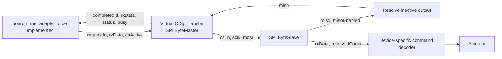

# SPI signal interface for boardrunner

[한국어 번역](spi_interface_ko.md)

**This English document is the source of truth.** Update it first and synchronize
the Korean translation. Contract ID: `spi_byte_signals_v0` (discussion draft).

## Scope

This standalone model accepts one byte request, synthesizes ideal CS/SCLK/MOSI
signals, samples MISO, and returns a received byte. A separate slave decodes the
signals so its received data can feed a device-specific actuator command decoder.
It is independent of propulsion fidelity and is not enabled in copter exports or
composer TOML. No boardrunner integration code is included in this change.

| Implemented | Deferred |
|---|---|
| 8-bit, full-duplex, modes 0–3, MSB/LSB first | 16/32-bit frames and runtime clock/mode changes |
| Host-controlled CS, multiple bytes under one assertion | Multiple slaves and shared-bus contention |
| One outstanding request, completion and cancellation | Request queues and automatic host scheduling |
| Ideal logical pins and explicit MISO output enable | Pin voltages, RLC, calibrated EMI coupling and setup/hold checks |
| Public pins where a signal disturbance can be inserted | Device-specific registers, FIFO, checksums and actuator command meanings |

## Composition

The namespace `SPI` in this diagram means `Logical.Communications.SPI`.
`Adapters.VirtualIO.SpiTransfer` exposes `ByteMaster` through a host-facing class.
Its generated waveform is a reconstruction from the request and configuration,
not an observation of boardrunner's physical or emulated GPIO timing.

`ByteSlave` contains only byte serialization/deserialization. It assigns no
universal throttle meaning to an SPI byte. The attached device owns that mapping.
`Examples.SpiTransfer` demonstrates two bytes under one CS assertion and exposes
`receivedCommand` as the received integer without attaching a motor.

## Host contract

One adapter instance represents one slave endpoint. The host selects the instance
by bus/CS routing outside this model. Parameters are fixed for a simulation:
`clockFrequency` [Hz], `cpol`, `cpha`, and `msbFirst`. The example clock is 1 MHz;
this is an illustrative setting, not an identified board clock.

| Direction | Port | Meaning |
|---|---|---|
| Host → model | `requestId: Integer` | Starts at 0; increases for every submitted byte, even if data repeats |
| Host → model | `txData: Integer` | Unsigned byte in 0…255; latched when a request is accepted |
| Host → model | `csActive: Boolean` | True asserts the active-low CS; host keeps it asserted across bytes |
| Model → host | `busy: Boolean` | One transfer is in progress |
| Model → host | `completedId: Integer` | Last retired request, including rejected or aborted requests |
| Model → host | `rxData: Integer` | Last successful MISO byte; unchanged on rejection/cancellation |
| Model → host | `status: Integer` | 0 idle/in progress, 1 success, 2 CS inactive, 3 aborted by CS release |
| Model → link | `cs_n, sclk, mosi: Boolean` | Ideal outgoing pin levels |
| Link → model | `miso: Boolean` | Resolved incoming pin level |

`requestId`, `completedId`, `status` and `busy` are simulation-interface metadata,
not additional physical SPI handshake pins. Check `completedId` together with
`status`; status 1 alone can still refer to a previous request.

Initialize with `requestId=0`. Assert CS before submission. Set `txData`, then
publish a new `requestId` in the same input update. Keep the request identifier
stable and wait until `completedId` matches it before submitting another byte.
Submitting while busy or supplying an invalid byte is a contract violation and
raises an assertion. CS release during a transfer cancels the outstanding request
and returns SCLK to its idle polarity. Inactive-CS requests retire with status 2.

A request starts with SCLK at `cpol`; the first edge is one half-period later.
There are 16 half-periods per successful byte:

\[
T_{half}=\frac{1}{2f_{SCLK}},\qquad T_{byte}=\frac{8}{f_{SCLK}}.
\]

CPHA=0 samples on leading edges and shifts on trailing edges. CPHA=1 shifts on
leading edges and samples on trailing edges. Sampling uses the line value just
before the sampling edge; data must be stable there. The model does not resolve
metastability or diagnose coincident data/clock changes.

## Slave endpoint and disturbance points

The slave receives `cs_n`, `sclk`, `mosi` and an unsigned response `txData`. Its
outputs are `miso`, `misoEnabled`, `rxData` and `receivedCount`. A receiver must
observe the count, not a change in data, to detect repeated identical bytes.

CS deassertion disables MISO and discards a partial byte. MISO's Boolean value
while disabled is only a placeholder; the example resolves it to a pulled-up
idle level. The placeholder is not an electrical Hi-Z simulation.

For CPHA=0 the response shift register loads at CS assertion and on each byte's
last trailing edge. For CPHA=1 it loads on the first leading edge of each byte.
Provide the response before the relevant load event and hold it stable around
that event. Response generation/register decoding belongs to the attached device.

A slave publishes a byte on its eighth sampling edge. For CPHA=0 this precedes
the master's final trailing edge. Releasing CS in that interval can abort the
master request even though the slave has already accepted the byte; cancellation
does not roll back a device-side command.

A disturbance block can be inserted on MOSI, MISO, SCLK or CS without changing
the host byte contract. `Tests.SpiDisruption` flips MOSI around one sampling edge
and verifies the changed slave byte. This demonstrates the injection boundary;
it does not assign an external EMI field strength, coupling gain or pin voltage.
A later electrical channel can replace each logical connection with driver,
line and receiver models while preserving the same byte-facing host contract.

## Mapping to current boardrunner APIs

The current SDK exposes `api_spi_set_cs(bus, cs_id, level)` and
`api_spi_transfer(bus, uint32_t value)`. The bus calls the selected slave's
`set_cs(level)` and `transfer(value)` callbacks. The transfer callback returns
synchronously. Its `uint32_t` argument is a container, not proof of a 32-bit SPI
frame. The current callback signature carries no clock frequency or bit timestamps.

Proposed mapping:

| Current operation | Proposed Modelica-side action |
|---|---|
| `set_cs(0)` / `set_cs(1)` | Set `csActive=true` / `false` on the routed endpoint |
| One verified 8-bit transfer | Set `txData`, increase `requestId`, apply inputs at the synchronized simulation time |
| Transfer result | After matching `completedId` and status 1, return `rxData` |
| Rejection/cancellation | Apply an explicitly agreed host/device error policy; do not return a stale byte as success |

The runtime bridge still needs to coordinate firmware time and model time.
A synchronous callback cannot set `txData` and immediately read a new `rxData`:
this model completes after `8/clockFrequency`. Simply advancing an FMU into the
future while leaving the firmware clock unchanged is not a defined integration.
The boardrunner discussion should settle these items:

1. Where bus ID, CS ID and actual frame width are obtained. The prototype accepts
   only 8-bit transfers; splitting wider frames needs a separate agreed rule.
2. Where clock frequency, mode and bit order come from, and whether initial
   configuration is sufficient or runtime reconfiguration is required.
3. Whether the bridge synchronously coordinates a transfer interval or schedules
   completion, including the ordering of CS changes and byte requests.
4. How input changes and Boolean/Integer events are delivered through the chosen
   FMI runtime, including abort status and repeated identical bytes.

The SPI pins belong inside the model or its connected endpoint. The host can
retain a byte-facing interface; it need not stream every SCLK edge across FMI.
This requires the bridge to keep command delivery and completion time causal.

## Validation

Native OpenModelica checks use `Examples.SpiTransfer`, `Tests.SpiSignals`, and
`Tests.SpiDisruption`. The tests cover modes 0–3, both bit orders, repeated bytes,
0/255 payloads, continuous CS, inactive-CS rejection, cancellation/recovery and
one logical MOSI disturbance. This is not boardrunner integration or Rumoca/FMI
runtime certification. Existing copter PWM and sensor ports are separate.
