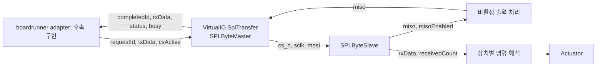

# boardrunner 연동을 위한 SPI 신호 인터페이스

[English — 기준 문서](spi_interface.md)

**영어 문서가 기준본입니다.** 영어를 먼저 수정하고 한국어 번역을 동기화합니다.
계약 ID: `spi_byte_signals_v0` — 인터페이스 논의를 위한 초안입니다.

## 범위

바이트 전송 요청 하나를 받아 이상적인 CS/SCLK/MOSI 신호를 만들고 MISO를
샘플링해 수신 바이트를 반환하는 독립 모델이다. 별도 slave가 신호를 해석하며,
복원한 바이트를 장치별 actuator 명령 해석기에 연결할 수 있다. 추진계 수준과
독립적이고, copter export나 composer TOML에는 활성화하지 않았다.
이번 변경에 boardrunner 연동 코드는 포함하지 않는다.

| 구현 범위 | 후속 범위 |
|---|---|
| 8비트, full-duplex, mode 0–3, MSB/LSB first | 16/32비트 프레임과 실행 중 클럭·모드 변경 |
| 호스트가 제어하는 CS, CS 유지 중 여러 바이트 | 여러 slave와 공유 버스 충돌 |
| 한 번에 한 요청, 완료·중단 상태 | 요청 큐와 호스트 자동 스케줄링 |
| 이상적인 논리 핀과 MISO 출력 활성화 | 핀 전압, RLC, 보정된 EMI 결합, setup/hold 검사 |
| 교란 모델을 삽입할 수 있는 공개 핀 | 장치별 레지스터, FIFO, 체크섬, actuator 명령 의미 |

## 구성

그림의 `SPI`는 `Logical.Communications.SPI`를 뜻한다.
`Adapters.VirtualIO.SpiTransfer`는 `ByteMaster`를 호스트 경계로 노출한다.
생성한 파형은 요청과 설정으로 재구성한 것이며, boardrunner의 실제 또는
에뮬레이션된 GPIO 타이밍을 관측한 결과가 아니다.

`ByteSlave`는 바이트 직렬화·역직렬화만 수행한다. SPI 바이트에 공통적인
throttle 의미를 부여하지 않고, 연결한 장치가 명령 의미를 정한다.
`Examples.SpiTransfer`는 CS를 한 번 유지하는 동안 두 바이트를 전달하고,
모터 연결 없이 수신 정수값을 `receivedCommand`로 노출한다.

## 호스트 계약

adapter 인스턴스 하나는 slave endpoint 하나를 나타낸다. 버스·CS에 따른
인스턴스 선택은 모델 바깥 호스트가 담당한다. `clockFrequency` [Hz], `cpol`,
`cpha`, `msbFirst`는 시뮬레이션 중 고정된 파라미터다. 예제의 1 MHz는
설명용 설정이며 식별된 보드 클럭이 아니다.

| 방향 | 포트 | 의미 |
|---|---|---|
| 호스트 → 모델 | `requestId: Integer` | 초기값 0; 데이터가 같아도 바이트를 보낼 때마다 증가 |
| 호스트 → 모델 | `txData: Integer` | 0…255의 unsigned 바이트; 요청 수락 시 저장 |
| 호스트 → 모델 | `csActive: Boolean` | true이면 active-low CS 활성화; 여러 바이트 사이에서도 유지 가능 |
| 모델 → 호스트 | `busy: Boolean` | 전송 진행 중 |
| 모델 → 호스트 | `completedId: Integer` | 거절·중단을 포함해 마지막으로 처리 종료한 요청 |
| 모델 → 호스트 | `rxData: Integer` | 마지막으로 정상 수신한 MISO 바이트; 거절·중단 시 유지 |
| 모델 → 호스트 | `status: Integer` | 0 초기/진행, 1 성공, 2 CS 비활성, 3 CS 해제로 중단 |
| 모델 → 링크 | `cs_n, sclk, mosi: Boolean` | 이상적인 출력 핀 레벨 |
| 링크 → 모델 | `miso: Boolean` | 비활성 출력 등을 처리한 입력 핀 레벨 |

`requestId`, `completedId`, `status`, `busy`는 시뮬레이션 경계의 메타데이터이며
실제 SPI에 추가된 handshake 핀이 아니다. `status=1`만 보면 이전 요청의 성공일
수 있으므로 `completedId`와 함께 확인한다.

`requestId=0`으로 초기화한다. 요청 전에 CS를 활성화하고, 같은 입력 갱신에서
`txData`를 설정한 뒤 새로운 `requestId`를 전달한다. 요청 번호를 유지하고
`completedId`가 일치한 후 다음 바이트를 요청한다. busy 중 요청하거나 범위를
벗어난 바이트를 전달하면 계약 위반으로 assertion이 발생한다. 전송 중 CS를
해제하면 진행 요청을 중단하고 SCLK를 idle polarity로 복귀시킨다.
CS가 비활성인 요청은 status 2로 처리 종료한다.

요청 시 SCLK는 `cpol` 상태이고 첫 에지는 반주기 후에 발생한다. 정상 바이트는
16개의 반주기로 구성된다.

\[
T_{half}=\frac{1}{2f_{SCLK}},\qquad T_{byte}=\frac{8}{f_{SCLK}}.
\]

CPHA=0은 leading edge에서 샘플링하고 trailing edge에서 shift한다. CPHA=1은
leading edge에서 shift하고 trailing edge에서 샘플링한다. 샘플링 에지 직전의
논리값을 사용하므로 해당 시점에는 데이터가 안정되어 있어야 한다.
Metastability나 데이터·클럭의 동시 변화 위반은 판정하지 않는다.

## Slave endpoint와 교란 삽입 위치

slave 입력은 `cs_n`, `sclk`, `mosi`, unsigned 응답 바이트 `txData`다.
출력은 `miso`, `misoEnabled`, `rxData`, `receivedCount`다. 같은 바이트가
반복될 수 있으므로 데이터 변화 대신 count를 관측해 수신을 식별한다.

CS 해제 시 MISO 출력을 비활성화하고 미완성 바이트를 버린다. 비활성 상태의
MISO Boolean 값은 placeholder이며, 예제는 이를 pull-up된 idle로 처리한다.
이 placeholder가 전기적인 Hi-Z를 시뮬레이션하는 것은 아니다.

CPHA=0의 응답 shift register는 CS 활성화 시점과 각 바이트의 마지막 trailing
edge에서 로드한다. CPHA=1은 각 바이트의 첫 leading edge에서 로드한다.
응답은 해당 로드 이벤트 전에 준비하고 그 주변에서 안정적으로 유지한다.
응답 생성과 레지스터 해석은 연결한 장치의 역할이다.

slave는 여덟 번째 샘플링 에지에서 바이트를 내보낸다. CPHA=0에서는 master의
마지막 trailing edge보다 이르다. 그 사이에 CS를 해제하면 slave가 이미
바이트를 받았더라도 master 요청이 중단될 수 있다. 중단은 장치가 받은
명령을 취소하거나 되돌리지 않는다.

호스트 바이트 계약을 유지하면서 MOSI, MISO, SCLK, CS 사이에 교란 블록을
삽입할 수 있다. `Tests.SpiDisruption`은 한 샘플링 에지 주변에서 MOSI를 뒤집고
수신 바이트 변화를 확인한다. 이는 주입 경계의 예시이며 외부 EMI 전계 세기,
결합 이득, 핀 전압을 부여한 물리 모델은 아니다. 이후 전기 채널을 구현하면
논리 연결을 드라이버·선로·수신기로 대체하고 호스트 바이트 계약은 유지할 수 있다.

## 현재 boardrunner API와의 대응

현재 SDK는 `api_spi_set_cs(bus, cs_id, level)`과
`api_spi_transfer(bus, uint32_t value)`를 노출한다. 버스는 선택한 slave의
`set_cs(level)`, `transfer(value)` 콜백을 호출하며 전송 콜백은 동기적으로
반환한다. `uint32_t` 인자는 데이터 컨테이너이며 32비트 SPI 프레임이라는
뜻은 아니다. 현재 콜백 인자에는 클럭 주파수나 비트별 시각이 없다.

제안하는 대응은 다음과 같다.

| 현재 동작 | 제안하는 Modelica 측 동작 |
|---|---|
| `set_cs(0)` / `set_cs(1)` | 라우팅한 endpoint의 `csActive=true` / `false` |
| 8비트임을 확인한 전송 | `txData` 설정, `requestId` 증가, 동기화된 시뮬레이션 시각에 입력 반영 |
| 전송 결과 | `completedId` 일치 및 status 1 확인 후 `rxData` 반환 |
| 거절·중단 | 합의한 호스트·장치 오류 정책 적용; 이전 바이트를 새 성공 응답으로 반환하지 않음 |

runtime bridge는 펌웨어 시간과 모델 시간을 조정해야 한다. 동기 콜백에서
`txData`만 설정하고 즉시 새 `rxData`를 읽을 수는 없다. 이 모델은
`8/clockFrequency` 후 완료된다. 펌웨어 시간을 그대로 둔 채 FMU만 미래로
진행시키는 것은 정의된 연동 방식이 아니다. boardrunner 측과 아래 사항을
먼저 합의해야 한다.

1. 버스 ID, CS ID, 실제 프레임 폭을 어디에서 얻을지. 초안은 8비트만 받으며,
   더 넓은 프레임을 나누려면 별도 규칙이 필요하다.
2. 클럭·모드·비트 순서의 출처와 초기 설정만으로 충분한지, 실행 중 변경도
   필요한지.
3. bridge가 전송 구간을 동기적으로 조정할지, 완료를 스케줄링할지. CS 변화와
   바이트 요청 순서도 포함한다.
4. 사용하는 FMI runtime에서 입력 변화와 Boolean/Integer 이벤트를 전달하는
   방식. 중단 상태와 동일 바이트 반복 전달도 포함한다.

SPI 핀은 모델 또는 연결한 endpoint 내부에 둘 수 있다. 호스트는 바이트 단위
인터페이스를 유지하고 모든 SCLK 에지를 FMI로 전달하지 않아도 된다.
이를 위해 bridge는 명령 전달과 완료 시간의 인과 관계를 보존해야 한다.

## 검증

OpenModelica native 검증 대상은 `Examples.SpiTransfer`, `Tests.SpiSignals`,
`Tests.SpiDisruption`이다. mode 0–3, 양쪽 비트 순서, 반복 바이트, 0/255 데이터,
CS 유지, 비활성 CS 거절, 중단·복구, 논리 MOSI 교란을 검사한다.
boardrunner 연동이나 Rumoca/FMI runtime 검증을 뜻하지 않는다.
기존 copter PWM·센서 포트와는 별도다.
